

  

<h1 align="center">Mindtalk</h1>

  <b>Talk. We'll type.</b> 
  Private dictation and meeting notes for the Mac, all on your Mac. 
  Hold a key and speak, and your words appear wherever your cursor is. 
  Record meetings in the room and on calls, keep your thoughts, and ask about all of it. 
  Superb Swedish, 25 languages in all.

  

  
  
  
  

<a href="README.sv.md">Läs på svenska</a>

<picture>
  <source media="(prefers-color-scheme: dark)" srcset="docs/images/en/hero-dark.png">
  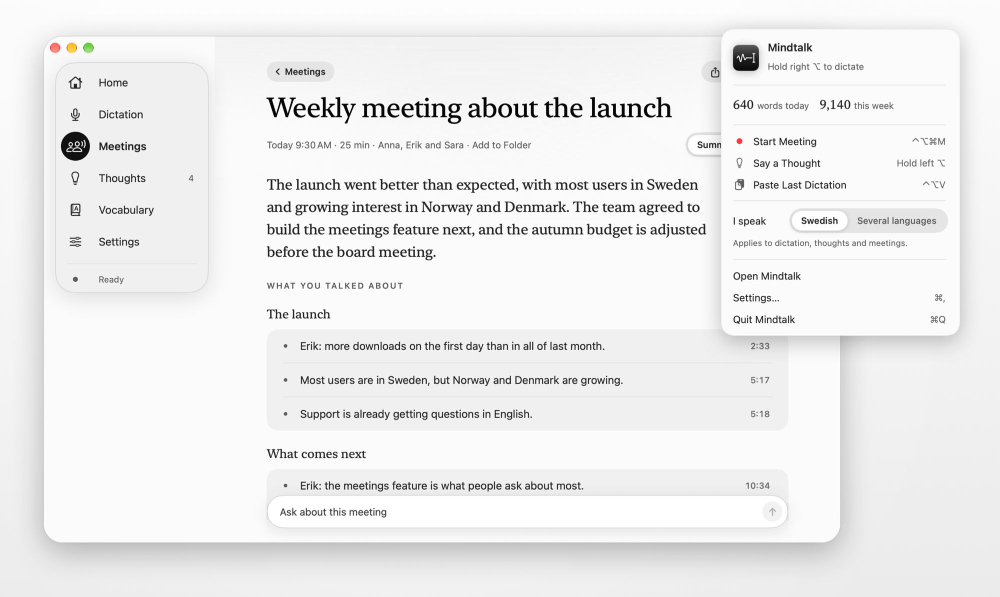
</picture>

## What's new in 2.0

Mindtalk 2.0 is more than dictation. Record meetings, keep your thoughts and ask your AI assistant about all of it, on your Mac.

- **Meetings in the room and on calls.** Mindtalk writes down what's said as it's said, keeps track of who is speaking, and writes a summary with what you talked about, decisions, tasks and what's worth remembering. No bot, no cloud.
- **Voices it recognizes.** Say your name once in a round of names, and Mindtalk knows you in the next meeting. Off until you turn it on.
- **Ask your meetings.** Ask one meeting, a folder or all of them. Every answer shows where in the meeting it comes from.
- **Connect Claude or ChatGPT.** Turn on MCP under Settings → AI apps, and your assistant can read your meetings and thoughts.
- **Thoughts.** Hold left ⌥ and say what comes to mind. It's saved on its own page, not typed where you are.
- **A new look and a faster start.** Home, a Dictation page with searchable history, Settings in five sections, and the speech model ready in about half a minute.

## Why Mindtalk

- **Everything stays on your Mac.** Speech, speakers, voices and summaries are all handled on your Mac. Dictation audio lives in memory and is gone the moment your text is typed. No account, no cloud, no analytics.
- **Swedish that actually sounds like Swedish.** Pick *Klang Pianissimo*, a Swedish speech model, or *Parakeet Ultra* for 25 languages, and switch with one click.
- **Works in every app.** Mail, Slack, Notes, your code editor, a browser field: if it has a text cursor, Mindtalk can type into it.
- **No bot in your meetings.** Mindtalk listens through your Mac's microphone, and on a call it also takes in the call app's sound. Nobody has to let anything into the call.
- **Fast.** A five-second sentence is transcribed in about a third of a second on Apple Silicon.
- **Calm by design.** A black-and-white look with serif titles, light (the default) or dark, a Swedish and English interface, and a menu bar panel in Liquid Glass.

## Features

### Meetings

| | |
|---|---|
| **In the room and on calls** | Press <kbd>⌃⌥⌘M</kbd> in any app, or Start meeting on Home or in the menu bar. Each time you choose between a round of names and starting right away. Nothing is recorded before you press. |
| **Calls in Teams, Zoom or Meet** | When a call app (Teams, Zoom, FaceTime, Slack, Webex, Discord, WhatsApp, Skype, or Meet in a browser) starts using the microphone, a small box asks whether to take notes. With headphones, the call's sound is taken in through system audio, so the other people are written down too. It is not screen recording. |
| **Live text, who said what** | The speech model writes what's said as it's said, about a second behind the voice. NVIDIA Nemotron 3 keeps up to 8 speakers apart. When the meeting ends, the whole recording is listened through again with more context. |
| **Voices it recognizes** | In a round of names, everyone says "Hi, my name is …", and each name lands on the voice that said it. With Remember voices on, a person you've named is recognized in later meetings. A TV or radio in the background is never given a name, and after a meeting you can mark a speaker as background sound. |
| **Notes and marks** | Type a note and press <kbd>↩</kbd> to pin it to that moment. Mark Decision, To do or Important with <kbd>⌥⌘1</kbd>, <kbd>⌥⌘2</kbd>, <kbd>⌥⌘3</kbd>. The summary builds on both. |
| **A summary that reads like notes** | An overview, what you talked about, decisions, to do with owners, and what's worth remembering. Every item has a time you can click to hear it, and each one is checked against the line in the transcript it came from. |
| **Your choice of writer** | Apple Intelligence (built in), Google's Gemma 4 (downloaded once in the app), or your own model in Ollama or LM Studio, reached only on 127.0.0.1. |
| **A panel beside your work** | During a meeting, a small floating panel shows the meeting when you switch to another app. It never takes the keyboard. |
| **Import a recording** | Drop an audio or video file on Meetings, or use Import File… (<kbd>⌘O</kbd>): mp3, m4a, wav, mp4, mov, webm and more. It becomes a meeting like any other. |
| **Share and export** | PDF, Word (.docx), Markdown or plain text, plus the audio (.m4a) and subtitles (.srt). |
| **Folders and search** | Sort meetings into folders, and search titles, summaries, notes and what was said with <kbd>⌘F</kbd>. |

### Ask, Thoughts and AI apps

| | |
|---|---|
| **Ask your meetings** | Ask one meeting, a folder, or all of them with <kbd>⌘K</kbd>. "What was decided this week?" Every answer names the meeting and the moment it came from, and says so when nothing matches instead of guessing. |
| **Thoughts** | Hold left ⌥, say what's on your mind, and let go. It's saved on the Thoughts page instead of being typed where you are. Pin, merge, tick off, share, and export to Markdown. |
| **Connect Claude or ChatGPT (MCP)** | Off by default. Turn it on under **Settings → AI apps**, and Claude, Claude Code, ChatGPT (Codex), Cursor and other MCP apps on your Mac can search and read your meetings and thoughts. Read-only, your dictations are not shared, and every read is logged. Every answer links back to the exact moment in Mindtalk. |
| **The command line** | `mindtalk meetings`, `search`, `thoughts` and `tasks`, with `--json`, under the same switch and the same log. |

### Dictation

| | |
|---|---|
| **Your shortcut, your way** | Hold any key or a combination of modifier keys to talk (right ⌥ Option by default). Double-tap, or press Space while holding, to lock hands-free. <kbd>Esc</kbd> cancels. Prefer tap-to-start? That's a setting. |
| **Two speech models** | Swedish (Klang Pianissimo) or multilingual (Parakeet Ultra). Download one or both during setup; switch with <kbd>⌘1</kbd> / <kbd>⌘2</kbd> in the menu bar. The choice applies to dictation and meetings. |
| **Text that's ready to send** | Filler sounds (*eh, öh, um*) disappear. Say *"new line"* or *"new paragraph"* for line breaks. |
| **Polish with Apple Intelligence** *(optional)* | Fixes punctuation, accidental repeats and self-corrections (*"Tuesday, no, I mean Wednesday"* → *"Wednesday"*), on-device. Guard-railed so it can only remove words, never add, answer or rephrase. |
| **Vocabulary** | Teach it names and terms. Split or misheard variants (*"Mind Talk"*) are corrected automatically, in dictation, thoughts, meetings and summaries. Ordinary words, addresses and text in capitals are left alone. |
| **Dictation history** | The last 50, kept on your Mac and searchable. Paste, copy or delete from each row. Landed in the wrong place? Put the cursor right and press <kbd>⌃⌥V</kbd> to paste it again. A dictation that failed can be tried again. |
| **Music pauses while you talk** | Spotify, Music and browser video pause while you dictate and resume afterwards. Other sound fades down; a call is turned down but never muted. |
| **Microphone picker** | Built-in mic by default, also with AirPods, because Bluetooth headsets lose quality when their mic opens. Or pick any input, with a live level meter to check it hears you. |
| **Statistics** | Words per day, time saved versus typing, your streak, on Home and the Dictation page. Numbers only; never the text. |
| **Stays up to date** | Checks for new versions once a day and offers them. Every update is signed with Mindtalk's own key and notarized by Apple, and it waits until a meeting being recorded is over. |

## A tour

### First launch

A seven-step introduction takes you from download to your first dictation: choose your language and download the speech model, grant three permissions, try dictation for real, then meet Thoughts and Meetings.

<table>
  <tr>
    <td width="33%"><picture><source media="(prefers-color-scheme: dark)" srcset="docs/images/en/onboarding-welcome-dark.png">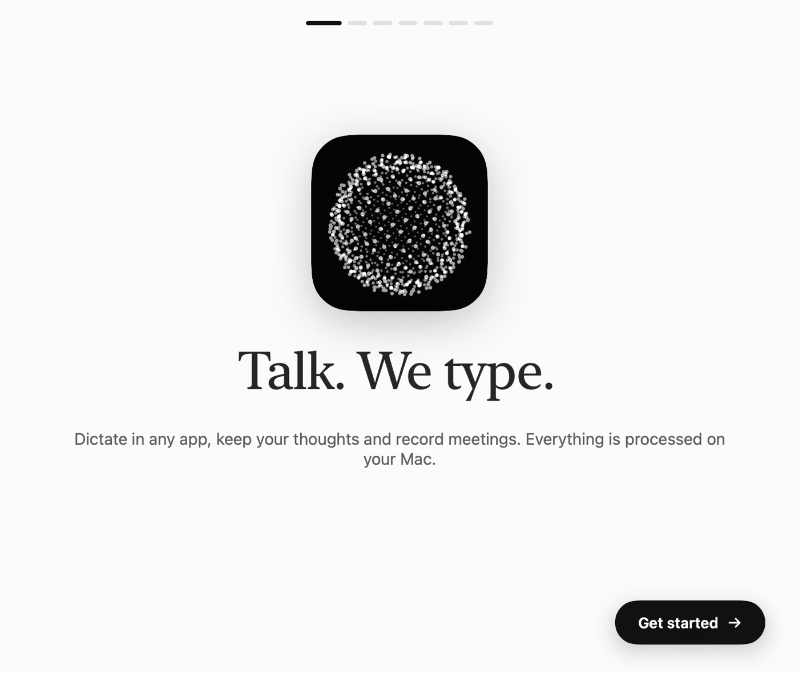</picture></td>
    <td width="33%"><picture><source media="(prefers-color-scheme: dark)" srcset="docs/images/en/onboarding-permissions-dark.png">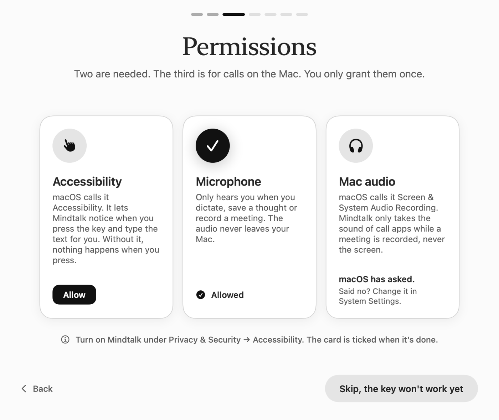</picture></td>
    <td width="33%"><picture><source media="(prefers-color-scheme: dark)" srcset="docs/images/en/onboarding-meetings-dark.png">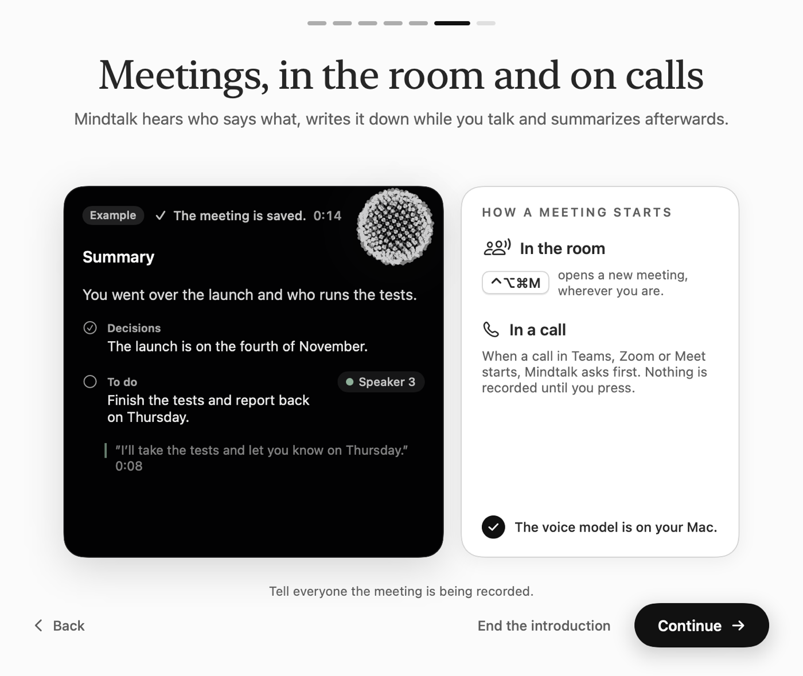</picture></td>
  </tr>
  <tr>
    <td align="center"><b>Welcome</b></td>
    <td align="center"><b>Three permissions, explained</b></td>
    <td align="center"><b>Meetings, in the room and on calls</b></td>
  </tr>
</table>

### Meetings

<table>
  <tr>
    <td width="50%"><picture><source media="(prefers-color-scheme: dark)" srcset="docs/images/en/meetings-dark.png">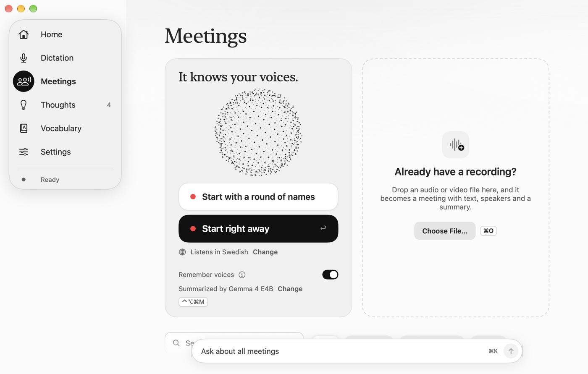</picture></td>
    <td width="50%"><picture><source media="(prefers-color-scheme: dark)" srcset="docs/images/en/meeting-dark.png">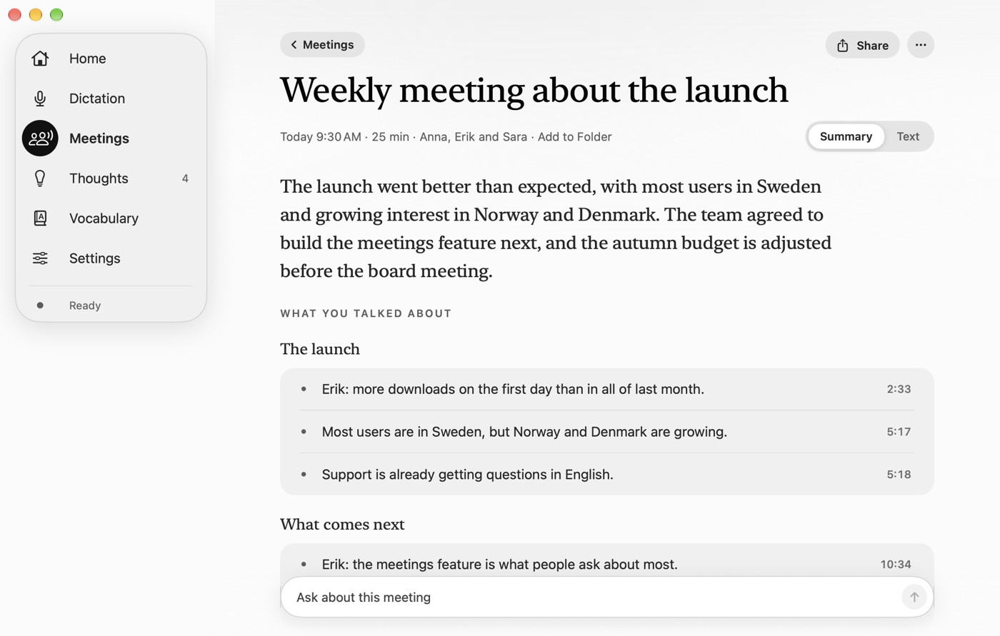</picture></td>
  </tr>
  <tr>
    <td align="center"><b>Meetings: start one, or drop a recording</b></td>
    <td align="center"><b>A meeting: the summary, with times you can click</b></td>
  </tr>
</table>

### The app

<table>
  <tr>
    <td width="50%"><picture><source media="(prefers-color-scheme: dark)" srcset="docs/images/en/home-dark.png">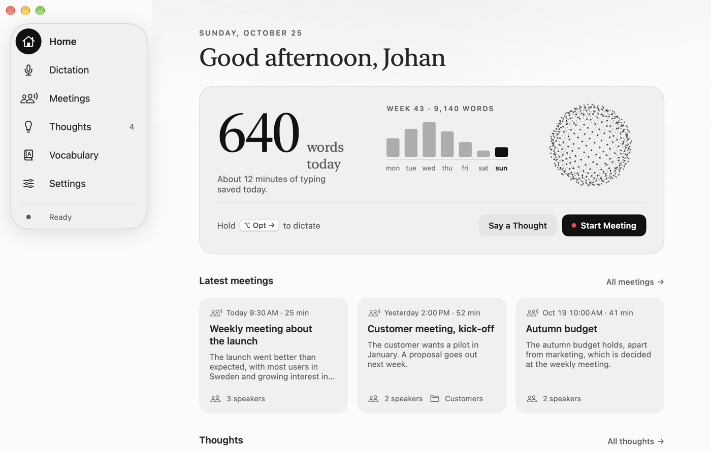</picture></td>
    <td width="50%"><picture><source media="(prefers-color-scheme: dark)" srcset="docs/images/en/thoughts-dark.png">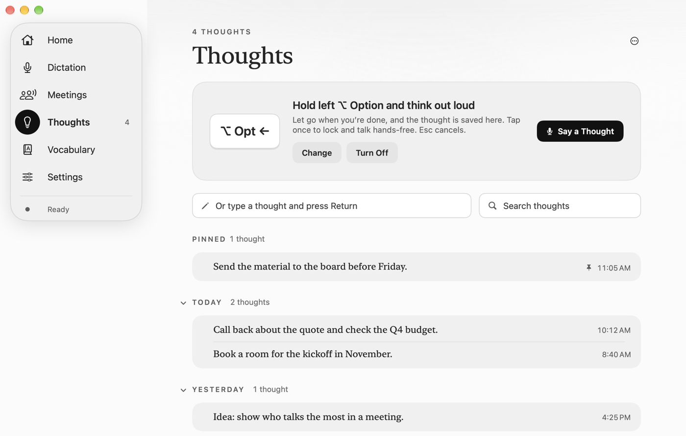</picture></td>
  </tr>
  <tr>
    <td align="center"><b>Home: your day, latest meetings and thoughts</b></td>
    <td align="center"><b>Thoughts: said, not typed</b></td>
  </tr>
  <tr>
    <td width="50%"><picture><source media="(prefers-color-scheme: dark)" srcset="docs/images/en/dictation-dark.png">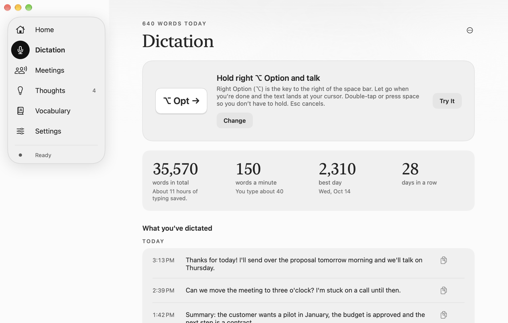</picture></td>
    <td width="50%"><picture><source media="(prefers-color-scheme: dark)" srcset="docs/images/en/settings-dark.png">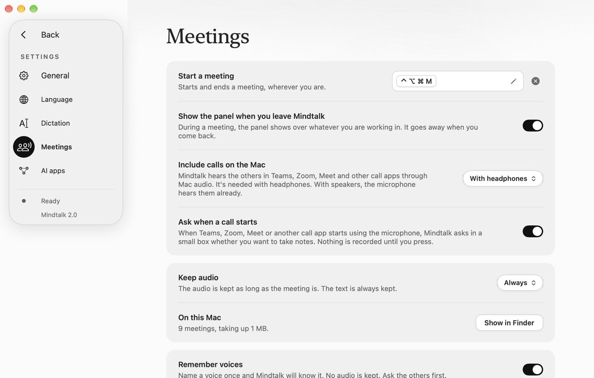</picture></td>
  </tr>
  <tr>
    <td align="center"><b>Dictation: your key, stats and history</b></td>
    <td align="center"><b>Settings, in five sections</b></td>
  </tr>
</table>

<picture><source media="(prefers-color-scheme: dark)" srcset="docs/images/en/panel-dark.png">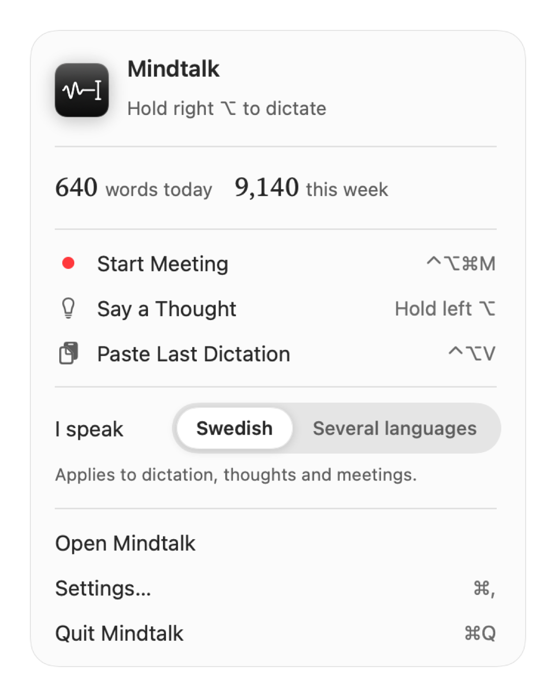</picture> <b>The menu bar panel</b>

## How it works

### Dictation

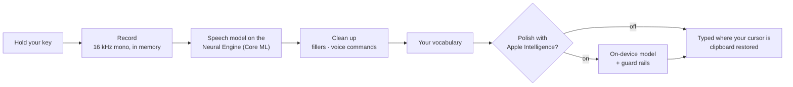

1. A **global key listener** (a Core Graphics event tap) notices your key, even while other apps are in front.
2. **Audio Queue** records from the chosen microphone by its device UID and converts the audio to 16 kHz mono, only while you hold the key.
3. **[FluidAudio](https://github.com/FluidInference/FluidAudio)** runs the Parakeet TDT speech model on the **Neural Engine** through Core ML. The very first time, the GPU writes while the Neural Engine is prepared in the background, so you can dictate after about half a minute.
4. **Rules** remove filler sounds and turn *"new line"* into line breaks, but not in *"add a new line to the table"*.
5. Your **vocabulary** fixes names and terms.
6. *Optional:* **Apple's on-device language model** (Foundation Models framework) polishes punctuation and self-corrections, line by line. Its answer is accepted only if it keeps the original's letters in order and just removes some, so it can never add words, answer a question in your text or rephrase you. Anything else, or a slow reply, and the rule-cleaned text is used.
7. The text is **pasted** where your cursor is and your clipboard is put back as it was. No text field there (the desktop, a web page)? It goes to the clipboard instead, and the indicator says so. Or turn on *Keep text on the clipboard* to always have it ready for <kbd>⌘V</kbd>.

### Meetings

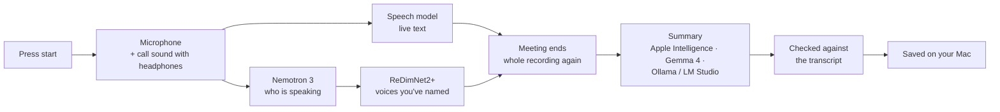

1. **You start it.** <kbd>⌃⌥⌘M</kbd> opens a new meeting, or the call box offers one when a call starts. Nothing records before you press.
2. **The microphone** in the room. Mindtalk uses the built-in mic by default, also with AirPods. On a call with headphones, the call app's sound is mixed in through a **Core Audio process tap** of the call apps only: not music, not notifications, not the screen.
3. **The speech model** writes the live text. The text is the speech model's own words, not a language model's.
4. **Nemotron 3** keeps up to 8 speakers apart, and **ReDimNet2+**, bundled in the app, compares each voice with the voices you've chosen to remember. Only a voiceprint of 192 numbers is kept, never audio of the voice.
5. **When the meeting ends,** the whole recording is listened through again with more context, and the names carry over.
6. **The summary** is written by the model you choose. Every item must point to a real line in the transcript, decisions and tasks must come from a sentence where something is decided or promised, and owners must be people in the meeting.

## Models

The speech models don't ship inside the app. You choose during setup; each downloads once from a pinned revision on Hugging Face, every file is checked against its SHA-256, and from then on everything works offline.

| | Model | By | Languages | Size |
|---|---|---|---|---|
| **Swedish** | [Klang Pianissimo](https://huggingface.co/KlangAI/pianissimo-sv) | Klang AI AB | Swedish, and it keeps up with English | 688 MB |
| **Multilingual** | [Parakeet Ultra](https://huggingface.co/moondream/parakeet-ultra) | Moondream | 25 European languages | 632 MB |

Both are fine-tuned from [NVIDIA Parakeet TDT 0.6B v3](https://huggingface.co/nvidia/parakeet-tdt-0.6b-v3) and licensed [CC BY 4.0](https://creativecommons.org/licenses/by/4.0/). Core ML conversions by [markstrom](https://huggingface.co/markstrom/pianissimo-sv-coreml) and [FluidInference](https://huggingface.co/FluidInference/parakeet-ultra-coreml).

For meetings and summaries:

| Model | What it does | By | Size |
|---|---|---|---|
| [Nemotron 3](https://huggingface.co/FluidInference/nemotron-3-diarization-coreml) | Keeps speakers apart | NVIDIA, Core ML by FluidInference | 400 MB, downloaded |
| [ReDimNet2+](https://huggingface.co/lab260/redimnet2-plus) | Recognizes voices | LAB260, built on ReDimNet2 by Palabra.ai | 13 MB, in the app |
| [Gemma 4 E4B](https://huggingface.co/google/gemma-4-E4B-it) *(optional)* | Writes summaries, titles and answers | Google DeepMind | 6.9 GB, for 16 GB of memory |
| [Gemma 4 26B](https://huggingface.co/google/gemma-4-26B-A4B-it) *(optional)* | The same, most accurate | Google DeepMind | 15.6 GB, for 32 GB of memory |

Without Gemma, summaries and answers are written by Apple Intelligence, or by your own model in Ollama or LM Studio.

## Privacy

- **No network**, except downloading the models you use and checking for updates. Ollama and LM Studio, if you choose them, are reached only on 127.0.0.1. Nothing you say, no text and no voiceprint is sent anywhere by Mindtalk.
- **Text leaves your Mac only through MCP**, if you turn it on and ask your AI assistant yourself. That app's provider then receives the text it read. MCP is off by default and read-only, your dictations are not shared, audio and voiceprints are never shared, a meeting can't be read while it's being recorded or in the two minutes after, and every read is logged under Settings → AI apps.
- **Dictation audio is never written to disk.** It's transcribed from memory and discarded.
- **Meetings** are stored in `~/Library/Application Support/Mindtalk/Meetings` (audio, text, your notes, the summary), readable only by your user account. You choose how long the audio is kept (always, or 90, 30 or 7 days); the text stays until you delete the meeting. Deleted meetings go to the Trash.
- **Calls:** only the sound of call apps, only while a meeting is recorded, and only with headphones unless you choose otherwise. It is not screen recording.
- **Recognizing voices is off until you turn it on,** and Mindtalk asks you to get the others' consent first. Then a voiceprint (not audio) of each person you name is kept on your Mac, so they're recognized in later meetings. You can forget one person or everyone at any time.
- **Thoughts** keep only the text. The sound is kept only until the text is written.
- **Dictation history** (the last 50) is stored in `~/Library/Application Support/Mindtalk`, readable only by your user account, and can be cleared at any time.
- **Password fields:** text dictated into one is typed but never kept: not in the history, not in the statistics, not in the clipboard.
- **Statistics** count words and seconds per day, never the text itself.
- **Permissions:** Microphone to hear you, Accessibility to notice your keys and to paste, and Screen & System Audio Recording (the system audio part) for calls on the Mac.
- **The AI polish is guard-railed:** its answer is used only if it merely removes fillers, repeats or what a self-correction replaces. It can never add words, drop a "not", or answer your text.

## Install

1. [Download Mindtalk](https://github.com/dragon6sic6/Mindtalk/releases/latest/download/Mindtalk.dmg), signed with Developer ID and notarized by Apple.
2. Open the DMG and drag **Mindtalk** to **Applications**.
3. Open Mindtalk. The introduction walks you through the rest. (Opened it straight from the DMG or Downloads? Mindtalk offers to move itself into Applications.)

From then on Mindtalk checks for updates and offers them. See what's new under [Releases](https://github.com/dragon6sic6/Mindtalk/releases).

**Requirements:** a Mac with Apple Silicon (M1 or later) and macOS 26 Tahoe or later. Disk: about 700 MB per speech model, plus 400 MB for the meetings voice model, and 6.9 GB or 15.6 GB if you choose Gemma. *Polish with AI* needs Apple Intelligence, and so do summaries and Ask unless you use Gemma, Ollama or LM Studio.

## Keyboard

Choose your shortcuts in **Settings → General → Shortcuts**, or change the dictation key right on the Dictation page. Click a shortcut field, hold the modifiers you want together (for example, **right Option + right Command**), then release them to save. Left and right modifiers are distinct. You can also press a single regular key. <kbd>Esc</kbd> cancels the selection.

In hold mode, a modifier combination starts dictation once every selected modifier is held and finishes when you release any of them.

For **Say a thought**, choose one or more modifiers in the same way, in Settings or on the Thoughts page. Hold all selected keys to record and release any one to save the thought; a quick tap keeps listening hands-free. Option, Command, Control, Shift and Fn/Globe can be combined, including left/right variants. The thought and dictation shortcuts must use separate modifier keys. Typing or clicking with the selected modifiers still works as usual.

| | |
|---|---|
| Hold your shortcut | Talk; let go to type |
| Double-tap your shortcut | Lock hands-free; tap again to finish |
| <kbd>Space</kbd> while holding | Lock hands-free |
| <kbd>Esc</kbd> | Cancel without typing anything |
| Hold left <kbd>⌥</kbd> | Say a thought (right ⌘ or <kbd>⌃⌥T</kbd> if your dictation key already uses left ⌥) |
| <kbd>⌃⌥⌘M</kbd> | Start a new meeting, from any app |
| <kbd>⌥⌘P</kbd> | Pause or resume the meeting |
| <kbd>⌥⌘1</kbd> / <kbd>⌥⌘2</kbd> / <kbd>⌥⌘3</kbd> | Mark Decision / To do / Important |
| <kbd>⌘K</kbd> | Ask all your meetings |
| <kbd>⌘O</kbd> | Import a recording |
| <kbd>⌘1</kbd> / <kbd>⌘2</kbd> | Swedish / multilingual (in the menu bar panel) |
| <kbd>⌃⌥V</kbd> | Paste the last dictation again |
| <kbd>⌘,</kbd> | Settings |

## Built with

- **Swift, SwiftUI and AppKit**: a menu bar app for macOS 26
- **[FluidAudio](https://github.com/FluidInference/FluidAudio)**: the speech and speaker models on the Neural Engine via Core ML
- **Core ML**: ReDimNet2+, the voice model included in the app
- **Foundation Models**: Apple's on-device language model, for the optional polish and for summaries and answers
- **[MLX Swift](https://github.com/ml-explore/mlx-swift)** and **mlx-swift-lm**: Gemma 4 on your Mac's GPU
- **Core Audio**: microphone selection, device changes, knowing which apps are playing sound, and the process tap for calls
- **Audio Queue**: capture from the chosen input device and conversion to 16 kHz mono
- **Core Graphics event taps**: the global keys for dictation, thoughts and meetings
- **MCP over a local Unix socket**: a small helper inside the app that only your user account can reach
- **ServiceManagement**: open at login
- **[Sparkle](https://sparkle-project.org)**: signed automatic updates
- **String Catalogs**: Swedish and English interface
- **Icon Composer**: a layered Liquid Glass app icon
- **XcodeGen** and **dmgbuild**: reproducible project and a laid-out DMG

## Credits

Mindtalk is made by [Mindact Solutions AB](https://mindact.ai) in Sweden.

- Speech recognition by **Klang Pianissimo** (Klang AI AB) and **Parakeet Ultra** (Moondream), both built on **NVIDIA Parakeet TDT 0.6B v3**. CC BY 4.0.
- Speaker separation by **Nemotron 3** (NVIDIA, Core ML by FluidInference). OpenMDW 1.1.
- Voice recognition by **ReDimNet2+** (LAB260, built on ReDimNet2 by Palabra.ai). Apache 2.0.
- Summaries and answers, if you choose it, by **Gemma 4** (Google). Apache 2.0.
- Inference by **FluidAudio** (FluidInference). Apache 2.0.
- Updates by **Sparkle**. MIT.

Full credits and links are in the app under *About Mindtalk → Credits and Licenses…*.

## License

Mindtalk is free to use. © 2026 Mindact Solutions AB. This repository holds the releases and this page; the app is developed in a private repository. Code up to version 2.2 was published under the MIT License.

The downloaded models keep their own licenses (CC BY 4.0, OpenMDW 1.1, Apache 2.0). ReDimNet2+, the voice model included in the app, is under Apache 2.0. Full credits are in the app under *About Mindtalk → Credits and Licenses…*.

Found a bug or have an idea? [Open an issue](https://github.com/dragon6sic6/Mindtalk/issues).
