

  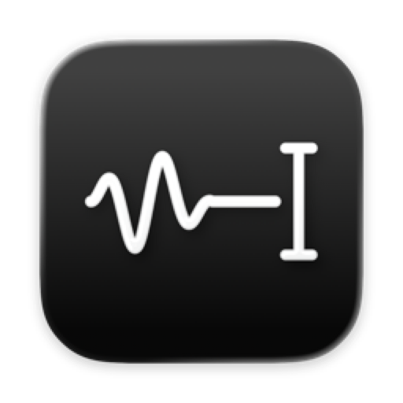

<h1 align="center">Mindtalk</h1>

  <b>Prata. Vi skriver.</b> 
  Diktering och mötesanteckningar för Mac, och allt stannar på din dator. 
  Håll in en tangent och prata, så hamnar texten där markören står. 
  Spela in möten i rummet och i samtal, spara dina tankar och fråga om allt. 
  Riktigt bra svenska, 25 språk totalt.

  

  
  
  
  

<a href="README.md">Read in English</a>

<picture>
  <source media="(prefers-color-scheme: dark)" srcset="docs/images/sv/hero-dark.png">
  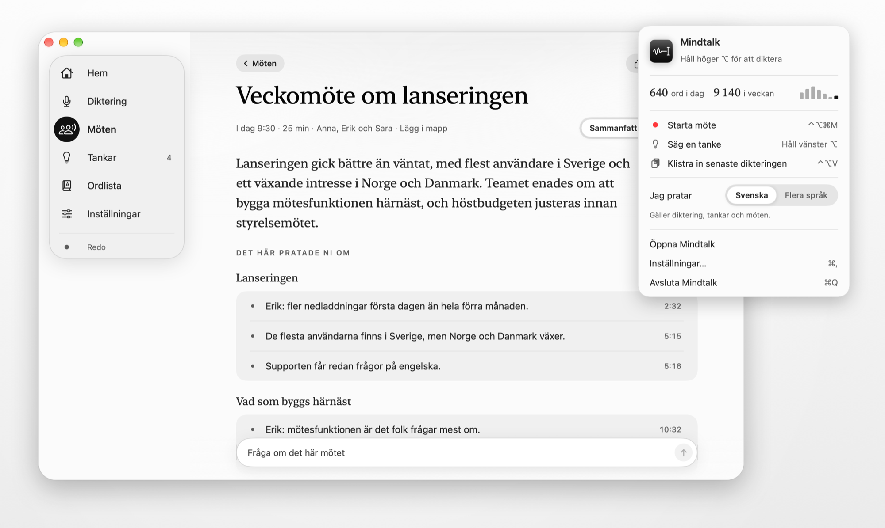
</picture>

## Nytt i 2.0

Mindtalk 2.0 är mer än diktering. Spela in möten, spara dina tankar och fråga din AI-assistent om allt, på din Mac.

- **Möten i rummet och i samtal.** Mindtalk skriver ned det som sägs medan det sägs, håller isär vem som pratar och skriver en sammanfattning med vad ni pratade om, beslut, att göra och det som är värt att komma ihåg. Ingen bot, inget moln.
- **Röster som känns igen.** Säg ditt namn en gång i en namnrunda, så känner Mindtalk igen dig i nästa möte. Det är av tills du slår på det.
- **Fråga dina möten.** Fråga ett möte, en mapp eller alla. Varje svar visar var i mötet det kommer ifrån.
- **Koppla Claude eller ChatGPT.** Slå på MCP under Inställningar → AI-appar, så kan din assistent läsa dina möten och tankar.
- **Tankar.** Håll in vänster ⌥ och säg det du kommer på. Tanken sparas på en egen sida, inte där du står.
- **Ny design och snabbare start.** Hem, en ny sida för diktering med sökbar historik, inställningar i fem avsnitt, och talmodellen är igång på ungefär en halv minut.

## Därför Mindtalk

- **Allt stannar på din Mac.** Tal, talare, röster och sammanfattningar hanteras på din dator. Ljudet från en diktering finns bara i minnet och försvinner så fort texten är inskriven. Inget konto, inget moln, ingen spårning.
- **Svenska som låter som svenska.** Välj *Klang Pianissimo*, en svensk talmodell, eller *Parakeet Ultra* för 25 språk. Du byter med ett klick.
- **Fungerar i alla appar.** Mail, Slack, Anteckningar, kodeditorn eller ett fält i webbläsaren. Har den en textmarkör kan Mindtalk skriva där.
- **Ingen bot i dina möten.** Mindtalk lyssnar med datorns mikrofon, och i ett samtal tar den också in ljudet från samtalsappen. Ingen behöver släppa in något i samtalet.
- **Snabb.** En mening på fem sekunder tolkas på ungefär en tredjedels sekund på Apple Silicon.
- **Lugn design.** Svart och vitt med rubriker i serif, ljust läge som standard eller mörkt, svenskt och engelskt gränssnitt, och en menyradspanel i Liquid Glass.

## Funktioner

### Möten

| | |
|---|---|
| **I rummet och i samtal** | Tryck <kbd>⌃⌥⌘M</kbd> i vilken app som helst, eller Starta möte på Hem eller i menyraden. Varje gång väljer du mellan att börja med en namnrunda och att starta direkt. Inget spelas in innan du trycker. |
| **Samtal i Teams, Zoom eller Meet** | När en samtalsapp (Teams, Zoom, FaceTime, Slack, Webex, Discord, WhatsApp, Skype eller Meet i webbläsaren) börjar använda mikrofonen frågar en liten ruta om du vill anteckna samtalet. Med hörlurar tas samtalets ljud in via systemljudet, så att de andra också skrivs ned. Det är ingen skärminspelning. |
| **Text direkt, och vem som sa vad** | Talmodellen skriver det som sägs medan det sägs, ungefär en sekund efter rösten. NVIDIA Nemotron 3 håller isär upp till 8 talare. När mötet är slut lyssnar Mindtalk igenom hela inspelningen en gång till, med mer sammanhang. |
| **Röster som känns igen** | I en namnrunda säger var och en ”Hej, jag heter …”, och varje namn hamnar på rösten som sa det. Med Kom ihåg röster påslaget känns en person du har namngett igen i kommande möten. En tv eller radio i bakgrunden får aldrig ett namn, och efter mötet kan du markera en talare som ljud i bakgrunden. |
| **Anteckningar och markeringar** | Skriv en anteckning och tryck <kbd>↩</kbd>, så hamnar den vid just det ögonblicket. Markera Beslut, Att göra eller Viktigt med <kbd>⌥⌘1</kbd>, <kbd>⌥⌘2</kbd> och <kbd>⌥⌘3</kbd>. Sammanfattningen bygger på båda. |
| **En sammanfattning som läses som anteckningar** | En översikt, det här pratade ni om, beslut, att göra med vem som ansvarar, och det som är värt att komma ihåg. Varje punkt har en tid du kan klicka på för att lyssna, och varje punkt kontrolleras mot raden i utskriften den kommer från. |
| **Du väljer vem som skriver** | Apple Intelligence (inbyggt), Googles Gemma 4 (laddas ned en gång i appen) eller din egen modell i Ollama eller LM Studio, som bara nås på 127.0.0.1. |
| **En panel bredvid ditt arbete** | Under ett möte visas mötet i en liten flytande panel när du byter till en annan app. Den tar aldrig tangentbordet. |
| **Importera en inspelning** | Släpp en ljud- eller videofil på Möten, eller välj Importera fil… (<kbd>⌘O</kbd>). Det går med mp3, m4a, wav, mp4, mov, webm och fler. Filen blir ett möte som alla andra. |
| **Dela och exportera** | PDF, Word (.docx), Markdown eller vanlig text, och dessutom ljudet (.m4a) och undertexter (.srt). |
| **Mappar och sök** | Sortera möten i mappar, och sök i titlar, sammanfattningar, anteckningar och det som sades med <kbd>⌘F</kbd>. |

### Fråga, Tankar och AI-appar

| | |
|---|---|
| **Fråga dina möten** | Fråga ett möte, en mapp eller alla med <kbd>⌘K</kbd>. ”Vad bestämdes den här veckan?” Varje svar säger vilket möte och vilket ögonblick det kommer från. Finns inget svar säger Mindtalk det i stället för att gissa. |
| **Tankar** | Håll in vänster ⌥, säg det du tänker på och släpp. Tanken sparas på sidan Tankar och skrivs inte in där du står. Fäst, slå ihop, bocka av, dela och exportera till Markdown. |
| **Koppla Claude eller ChatGPT (MCP)** | Avstängt från början. Slå på det under **Inställningar → AI-appar**, så kan Claude, Claude Code, ChatGPT (Codex), Cursor och andra MCP-appar på din Mac söka i och läsa dina möten och tankar. De kan bara läsa, dina dikteringar delas inte, och varje läsning syns i en logg. Varje svar länkar tillbaka till rätt ögonblick i Mindtalk. |
| **Kommandoraden** | `mindtalk meetings`, `search`, `thoughts` och `tasks`, med `--json`. Samma brytare och samma logg gäller. |

### Diktering

| | |
|---|---|
| **Din genväg, ditt sätt** | Håll in valfri tangent, eller flera tangenter som ⌥ och ⌘ samtidigt, och prata (höger ⌥ Option som standard). Dubbeltryck, eller tryck på mellanslag medan du håller in, för att låsa handsfree. <kbd>Esc</kbd> avbryter. Vill du hellre trycka för att starta? Det är en inställning. |
| **Två talmodeller** | Svenska (Klang Pianissimo) eller flerspråkig (Parakeet Ultra). Ladda ned en eller båda i introduktionen och byt med <kbd>⌘1</kbd> / <kbd>⌘2</kbd> i menyraden. Valet gäller både diktering och möten. |
| **Text som är klar att skicka** | Tvekljud (*eh, öh, um*) försvinner. Säg *”ny rad”* eller *”nytt stycke”* för radbrytningar. |
| **Putsa med Apple Intelligence** *(valfritt)* | Rättar skiljetecken, upprepningar och självrättelser (*”tisdag, nej jag menar onsdag”* → *”onsdag”*) på datorn. Med skyddsspärrar: den kan bara ta bort ord, aldrig lägga till, svara eller formulera om. |
| **Ordlista** | Lär den namn och begrepp. Delade eller felhörda varianter (*”Mind Talk”*) rättas automatiskt, i diktering, tankar, möten och sammanfattningar. Vanliga ord, adresser och text i versaler lämnas orörda. |
| **Historik** | De senaste 50 dikteringarna, sparade på din Mac och sökbara. Klistra in, kopiera eller ta bort från varje rad. Hamnade texten fel? Ställ markören rätt och tryck <kbd>⌃⌥V</kbd>. En diktering som misslyckades kan du prova igen. |
| **Musiken pausas medan du pratar** | Spotify, Musik och video i webbläsaren pausas under dikteringen och fortsätter efteråt. Annat ljud tonas ner. Ett samtal sänks men tystas aldrig. |
| **Mikrofonval** | Inbyggd mikrofon som standard, även med AirPods, eftersom Bluetooth-headset tappar kvalitet när deras mikrofon öppnas. Du kan också välja valfri enhet, med en nivåmätare som visar att den hör dig. |
| **Statistik** | Ord per dag, sparad tid jämfört med att skriva och dagar i rad, på Hem och på sidan Diktering. Bara siffror, aldrig texten. |
| **Håller sig uppdaterad** | Söker efter nya versioner en gång om dagen och erbjuder dem. Varje uppdatering är signerad med Mindtalks egen nyckel och notariserad av Apple, och den väntar tills ett möte som spelas in är klart. |

## En rundtur

### Första starten

En introduktion i sju steg tar dig från nedladdning till första dikteringen. Du väljer språk och laddar ned talmodellen, ger tre behörigheter, provar att diktera på riktigt och får sedan se Tankar och Möten.

<table>
  <tr>
    <td width="33%"><picture><source media="(prefers-color-scheme: dark)" srcset="docs/images/sv/onboarding-welcome-dark.png">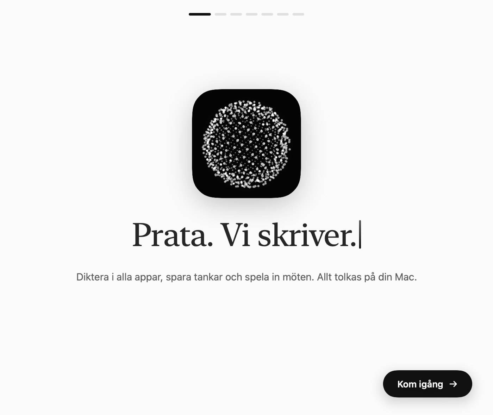</picture></td>
    <td width="33%"><picture><source media="(prefers-color-scheme: dark)" srcset="docs/images/sv/onboarding-permissions-dark.png">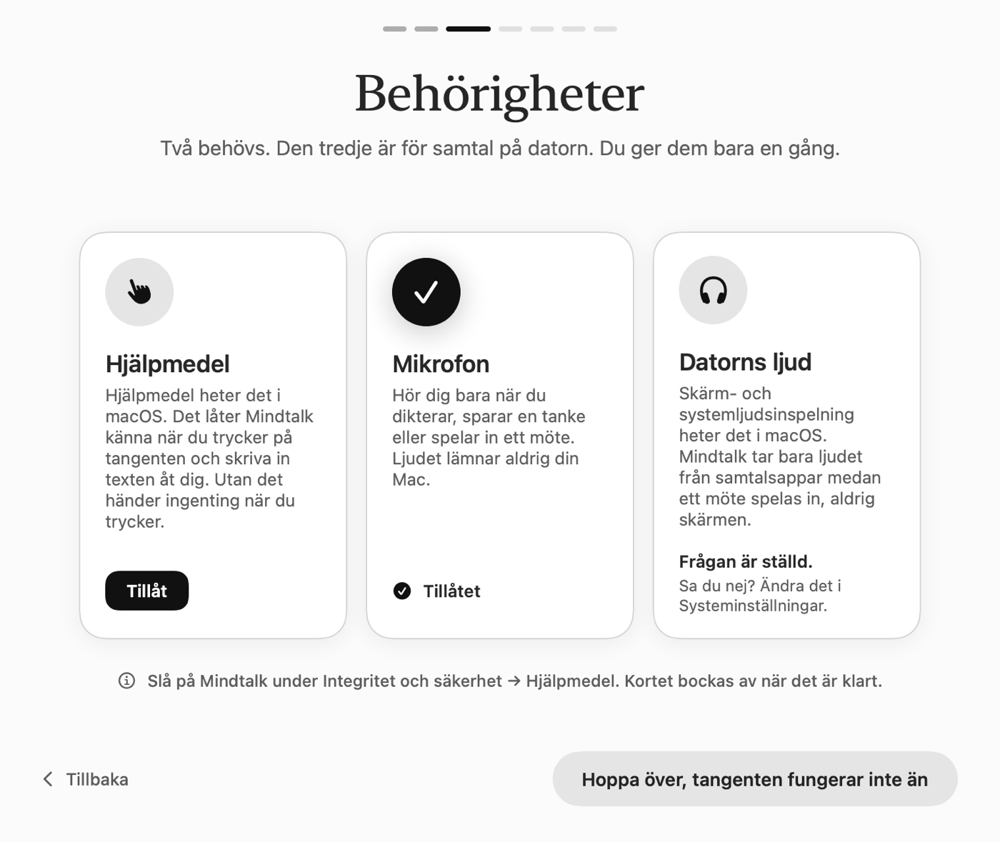</picture></td>
    <td width="33%"><picture><source media="(prefers-color-scheme: dark)" srcset="docs/images/sv/onboarding-meetings-dark.png">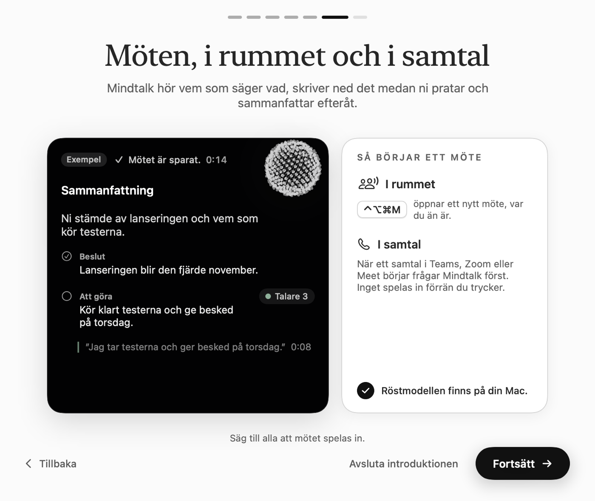</picture></td>
  </tr>
  <tr>
    <td align="center"><b>Välkommen</b></td>
    <td align="center"><b>Tre behörigheter, förklarade</b></td>
    <td align="center"><b>Möten i rummet och i samtal</b></td>
  </tr>
</table>

### Möten

<table>
  <tr>
    <td width="50%"><picture><source media="(prefers-color-scheme: dark)" srcset="docs/images/sv/meetings-dark.png">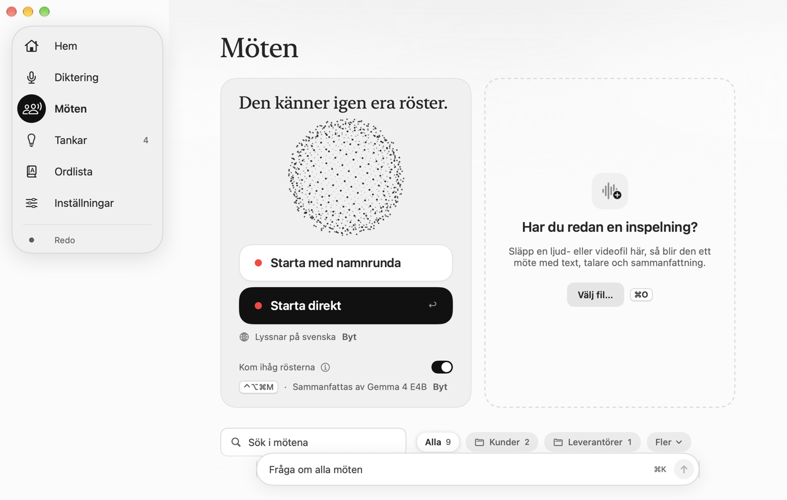</picture></td>
    <td width="50%"><picture><source media="(prefers-color-scheme: dark)" srcset="docs/images/sv/meeting-dark.png">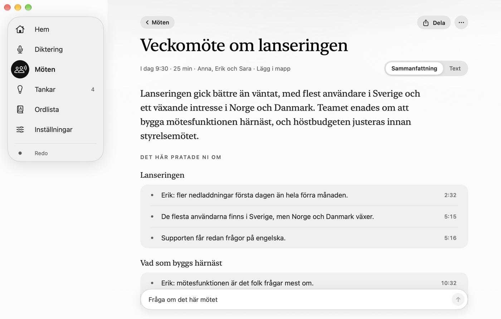</picture></td>
  </tr>
  <tr>
    <td align="center"><b>Möten: starta ett, eller dra hit en inspelning</b></td>
    <td align="center"><b>Ett möte: sammanfattningen, med tider att klicka på</b></td>
  </tr>
</table>

### Appen

<table>
  <tr>
    <td width="50%"><picture><source media="(prefers-color-scheme: dark)" srcset="docs/images/sv/home-dark.png">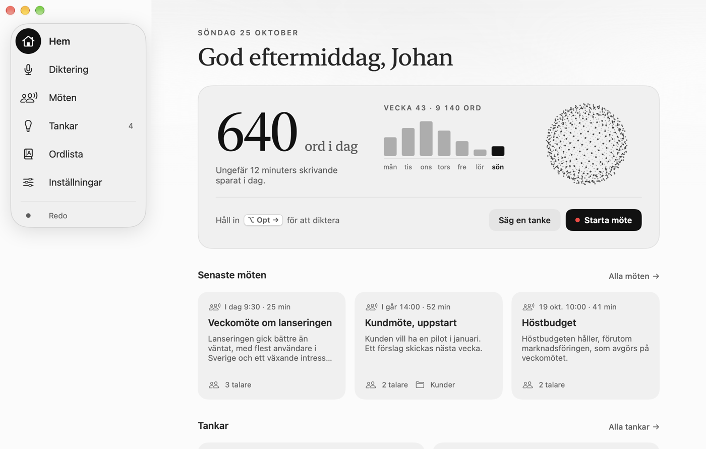</picture></td>
    <td width="50%"><picture><source media="(prefers-color-scheme: dark)" srcset="docs/images/sv/thoughts-dark.png">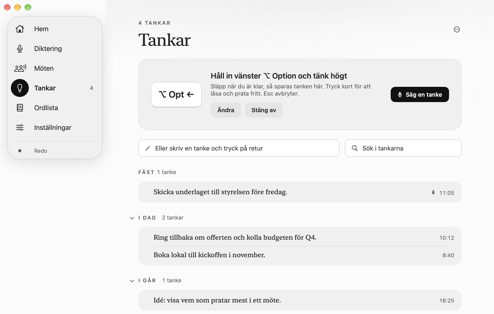</picture></td>
  </tr>
  <tr>
    <td align="center"><b>Hem: din dag, de senaste mötena och tankarna</b></td>
    <td align="center"><b>Tankar: sagda, inte skrivna</b></td>
  </tr>
  <tr>
    <td width="50%"><picture><source media="(prefers-color-scheme: dark)" srcset="docs/images/sv/dictation-dark.png">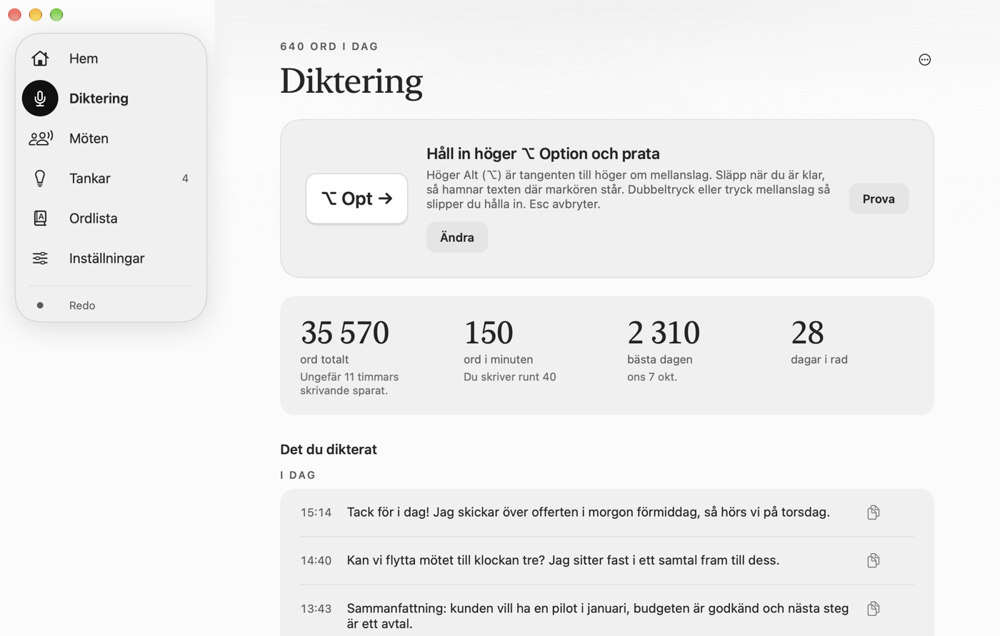</picture></td>
    <td width="50%"><picture><source media="(prefers-color-scheme: dark)" srcset="docs/images/sv/settings-dark.png">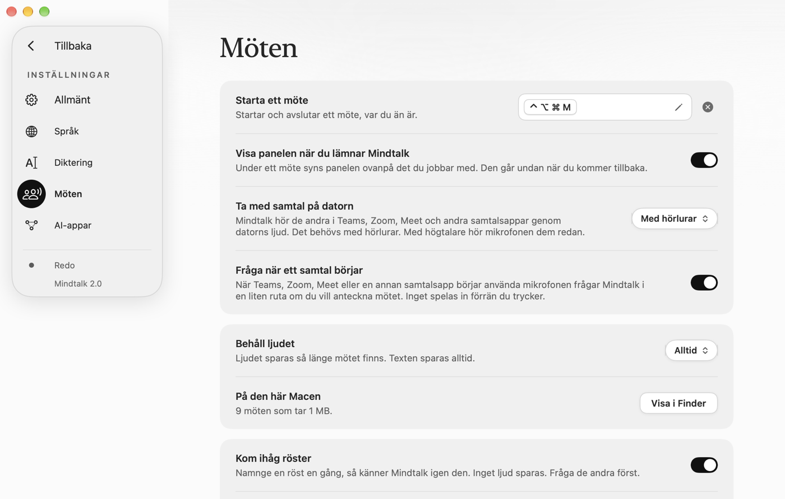</picture></td>
  </tr>
  <tr>
    <td align="center"><b>Diktering: din tangent, statistik och historik</b></td>
    <td align="center"><b>Inställningar i fem avsnitt</b></td>
  </tr>
</table>

<picture><source media="(prefers-color-scheme: dark)" srcset="docs/images/sv/panel-dark.png">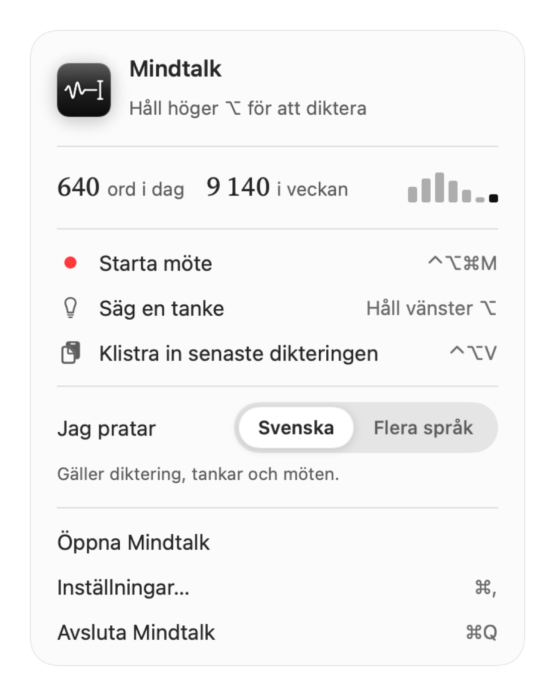</picture> <b>Menyradspanelen</b>

## Så fungerar det

### Diktering

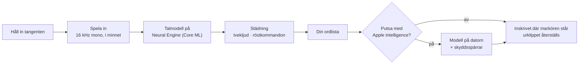

1. En **global tangentlyssnare** (Core Graphics event tap) märker din tangent även när andra appar ligger framme.
2. **Audio Queue** spelar in från mikrofonen du valt via enhetens UID och konverterar ljudet till 16 kHz mono, bara medan du håller in.
3. **[FluidAudio](https://github.com/FluidInference/FluidAudio)** kör talmodellen Parakeet TDT på **Neural Engine** via Core ML. Allra första gången skriver grafikkretsen medan Neural Engine förbereds i bakgrunden, så att du kan diktera efter ungefär en halv minut.
4. **Regler** tar bort tvekljud och gör *”ny rad”* till radbrytningar, men inte i *”lägg till en ny rad i tabellen”*.
5. Din **ordlista** rättar namn och begrepp.
6. *Valfritt:* **Apples språkmodell på enheten** (Foundation Models) putsar skiljetecken och självrättelser, rad för rad. Svaret används bara om det behåller originalets bokstäver i samma ordning och enbart tar bort några. Därför kan den aldrig lägga till ord, svara på en fråga i din text eller formulera om dig. Blir svaret något annat, eller dröjer det, används den regelstädade texten.
7. Texten **klistras in** där markören står och urklippet återställs. Finns inget textfält där (skrivbordet, en webbsida)? Då hamnar texten i urklipp i stället, och indikatorn säger det. Du kan också slå på *Behåll texten i urklipp* för att alltid ha den redo för <kbd>⌘V</kbd>.

### Möten

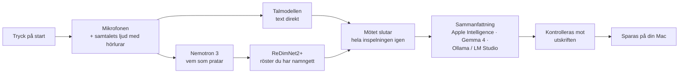

1. **Du startar själv.** <kbd>⌃⌥⌘M</kbd> öppnar ett nytt möte, eller så frågar rutan vid samtal när ett samtal börjar. Inget spelas in innan du trycker.
2. **Mikrofonen** i rummet. Mindtalk använder den inbyggda mikrofonen som standard, även med AirPods. I ett samtal med hörlurar blandas samtalsappens ljud in via en **Core Audio process tap** som bara tar samtalsapparna. Inte musik, inte notiser och inte skärmen.
3. **Talmodellen** skriver texten medan mötet pågår. Texten är talmodellens egna ord och inte en språkmodells.
4. **Nemotron 3** håller isär upp till 8 talare, och **ReDimNet2+**, som följer med appen, jämför varje röst med de röster du har valt att komma ihåg. Det som sparas är ett röstavtryck, en lista med 192 siffror, och aldrig ljud av rösten.
5. **När mötet är slut** lyssnar Mindtalk igenom hela inspelningen en gång till med mer sammanhang, och namnen följer med.
6. **Sammanfattningen** skrivs av modellen du väljer. Varje punkt måste peka på en verklig rad i utskriften. Beslut och uppgifter måste komma från en mening där något bestäms eller lovas, och den som ansvarar måste vara med i mötet.

## Modeller

Talmodellerna följer inte med appen. Du väljer i introduktionen. Varje modell laddas ned en gång från en låst version på Hugging Face, varje fil kontrolleras mot sin SHA-256, och sedan fungerar allt offline.

| | Modell | Av | Språk | Storlek |
|---|---|---|---|---|
| **Svenska** | [Klang Pianissimo](https://huggingface.co/KlangAI/pianissimo-sv) | Klang AI AB | Svenska, och hänger med i engelska | 688 MB |
| **Flerspråkig** | [Parakeet Ultra](https://huggingface.co/moondream/parakeet-ultra) | Moondream | 25 europeiska språk | 632 MB |

Båda bygger vidare på [NVIDIA Parakeet TDT 0.6B v3](https://huggingface.co/nvidia/parakeet-tdt-0.6b-v3) och har licensen [CC BY 4.0](https://creativecommons.org/licenses/by/4.0/deed.sv). Core ML-versioner av [markstrom](https://huggingface.co/markstrom/pianissimo-sv-coreml) och [FluidInference](https://huggingface.co/FluidInference/parakeet-ultra-coreml).

För möten och sammanfattningar:

| Modell | Gör | Av | Storlek |
|---|---|---|---|
| [Nemotron 3](https://huggingface.co/FluidInference/nemotron-3-diarization-coreml) | Håller isär vem som pratar | NVIDIA, Core ML av FluidInference | 400 MB, laddas ned |
| [ReDimNet2+](https://huggingface.co/lab260/redimnet2-plus) | Känner igen röster | LAB260, byggd på ReDimNet2 av Palabra.ai | 13 MB, ingår i appen |
| [Gemma 4 E4B](https://huggingface.co/google/gemma-4-E4B-it) *(valfri)* | Skriver sammanfattningar, titlar och svar | Google DeepMind | 6,9 GB, för 16 GB minne |
| [Gemma 4 26B](https://huggingface.co/google/gemma-4-26B-A4B-it) *(valfri)* | Samma sak, mest träffsäker | Google DeepMind | 15,6 GB, för 32 GB minne |

Utan Gemma skrivs sammanfattningar och svar av Apple Intelligence, eller av din egen modell i Ollama eller LM Studio.

## Integritet

- **Inget nätverk**, förutom nedladdningen av modellerna du använder och sökningen efter uppdateringar. Ollama och LM Studio nås bara på 127.0.0.1, om du väljer dem. Inget du säger, ingen text och inget röstavtryck skickas iväg av Mindtalk.
- **Text lämnar din Mac bara genom MCP**, om du själv slår på det och frågar din AI-assistent. Då får den appens leverantör texten den läste. MCP är avstängt från början och kan bara läsa. Dina dikteringar delas inte, ljud och röstavtryck delas aldrig, ett möte går inte att läsa medan det spelas in eller de två första minuterna efteråt, och varje läsning syns i en logg under Inställningar → AI-appar.
- **Ljudet från en diktering sparas aldrig.** Det tolkas från minnet och kastas.
- **Möten** sparas i `~/Library/Application Support/Mindtalk/Meetings` (ljud, text, dina anteckningar, sammanfattningen), läsbara bara för ditt användarkonto. Du väljer hur länge ljudet sparas (alltid, eller 90, 30 eller 7 dagar). Texten finns kvar tills du tar bort mötet, och borttagna möten hamnar i papperskorgen.
- **Samtal:** bara ljudet från samtalsappar, bara medan ett möte spelas in, och bara med hörlurar om du inte väljer något annat. Det är ingen skärminspelning.
- **Att känna igen röster är avstängt tills du slår på det**, och Mindtalk ber dig fråga de andra först. Då sparas ett röstavtryck (inte ljud) av varje person du namnger, på din Mac, så att de känns igen i kommande möten. Du kan glömma en person eller alla när som helst.
- **Tankar** sparas bara som text. Ljudet finns kvar bara tills texten är skriven.
- **Historiken** (de 50 senaste dikteringarna) sparas i `~/Library/Application Support/Mindtalk`, läsbar bara för ditt användarkonto, och kan rensas när som helst.
- **Lösenordsfält:** text du dikterar i ett sådant skrivs in men sparas aldrig. Den hamnar varken i historiken, i statistiken eller i urklipp.
- **Statistiken** räknar ord och sekunder per dag, aldrig själva texten.
- **Behörigheter:** Mikrofon för att höra dig, Hjälpmedel för att känna av tangenterna och klistra in, och Skärm- och systemljudsinspelning (delen för systemljud) för samtal på datorn.
- **AI-putsningen har skyddsspärrar:** svaret används bara om det enbart tar bort tvekljud, upprepningar eller det en självrättelse ersätter. Den kan aldrig lägga till ord, ta bort ett ”inte” eller svara på din text.

## Installera

1. [Ladda ned Mindtalk](https://github.com/dragon6sic6/Mindtalk/releases/latest/download/Mindtalk.dmg). Den är signerad med Developer ID och notariserad av Apple.
2. Öppna DMG-filen och dra **Mindtalk** till **Program**.
3. Öppna Mindtalk. Introduktionen tar dig igenom resten. (Startade du den direkt från DMG-filen eller Hämtade filer? Mindtalk erbjuder sig att flytta till Program.)

Sedan söker Mindtalk själv efter uppdateringar och erbjuder dem. Nyheterna finns under [Releases](https://github.com/dragon6sic6/Mindtalk/releases).

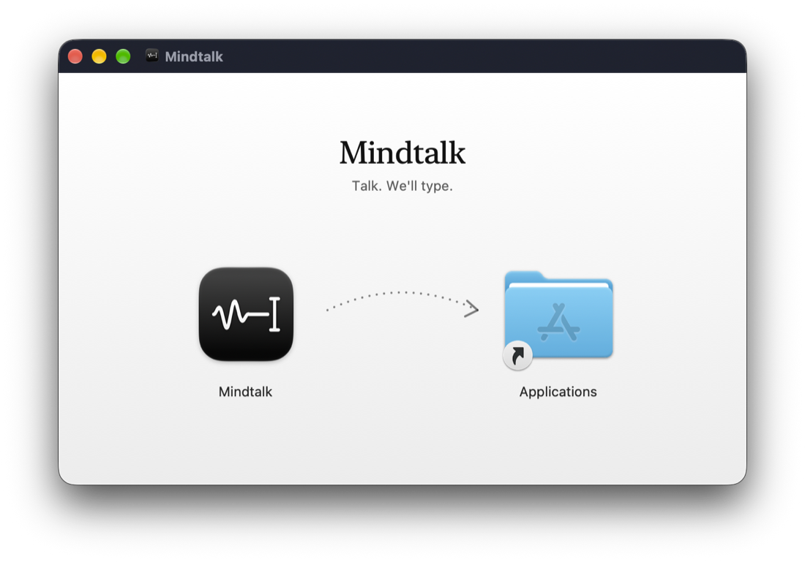

**Krav:** en Mac med Apple Silicon (M1 eller senare) och macOS 26 Tahoe eller senare. Ledigt utrymme: ungefär 700 MB per talmodell, 400 MB till röstmodellen för möten, och 6,9 GB eller 15,6 GB om du väljer Gemma. *Putsa med AI* kräver Apple Intelligence, och det gör också sammanfattningar och frågor om du inte använder Gemma, Ollama eller LM Studio.

## Tangentbord

Välj dina genvägar under **Inställningar → Allmänt → Genvägar**, eller byt dikteringstangent direkt på sidan Diktering. Klicka på ett genvägsfält, håll in de tangenter du vill använda samtidigt (till exempel **höger Option + höger Command**) och släpp för att spara. Vänster och höger räknas som olika tangenter. Du kan också trycka på en vanlig tangent. <kbd>Esc</kbd> avbryter valet.

I läget ”Bara håll in” startar dikteringen när alla valda tangenter hålls in, och den avslutas när du släpper någon av dem.

För **Säg en tanke** väljer du en eller flera tangenter, som ⌥ och ⌘, på samma sätt, i Inställningar eller på sidan Tankar. Håll in alla valda tangenter medan du pratar och släpp någon av dem för att spara tanken. Ett kort tryck låser i stället, så att du kan prata fritt. Option, Command, Control, Shift och Fn/Globe går att kombinera, och vänster och höger räknas för sig. Tankar och diktering kan inte dela någon tangent. Att skriva eller klicka med de valda tangenterna fungerar som vanligt.

| | |
|---|---|
| Håll in genvägen | Prata; släpp för att skriva in |
| Dubbeltryck | Lås handsfree; tryck igen när du är klar |
| <kbd>Mellanslag</kbd> medan du håller in | Lås handsfree |
| <kbd>Esc</kbd> | Avbryt utan att något skrivs |
| Håll in vänster <kbd>⌥</kbd> | Säg en tanke (höger ⌘ eller <kbd>⌃⌥T</kbd> om din dikteringstangent redan är vänster ⌥) |
| <kbd>⌃⌥⌘M</kbd> | Starta ett nytt möte, från vilken app som helst |
| <kbd>⌥⌘P</kbd> | Pausa eller fortsätt mötet |
| <kbd>⌥⌘1</kbd> / <kbd>⌥⌘2</kbd> / <kbd>⌥⌘3</kbd> | Markera Beslut / Att göra / Viktigt |
| <kbd>⌘K</kbd> | Fråga alla dina möten |
| <kbd>⌘O</kbd> | Importera en inspelning |
| <kbd>⌘1</kbd> / <kbd>⌘2</kbd> | Svenska / flerspråkig (i menyradspanelen) |
| <kbd>⌃⌥V</kbd> | Klistra in senaste dikteringen igen |
| <kbd>⌘,</kbd> | Inställningar |

## Byggd med

- **Swift, SwiftUI och AppKit**: en menyradsapp för macOS 26
- **[FluidAudio](https://github.com/FluidInference/FluidAudio)**: tal- och talarmodellerna på Neural Engine via Core ML
- **Core ML**: ReDimNet2+, röstmodellen som följer med appen
- **Foundation Models**: Apples språkmodell på enheten, för den valfria putsningen och för sammanfattningar och svar
- **[MLX Swift](https://github.com/ml-explore/mlx-swift)** och **mlx-swift-lm**: Gemma 4 på datorns grafikkrets
- **Core Audio**: mikrofonval, enhetsbyten, vilka appar som spelar ljud, och ljudet från samtal
- **Audio Queue**: inspelning från vald mikrofon och konvertering till 16 kHz mono
- **Core Graphics event taps**: de globala tangenterna för diktering, tankar och möten
- **MCP via en lokal Unix-socket**: en liten hjälpare i appen som bara ditt användarkonto kommer åt
- **ServiceManagement**: starta vid inloggning
- **[Sparkle](https://sparkle-project.org)**: signerade automatiska uppdateringar
- **String Catalogs**: svenskt och engelskt gränssnitt
- **Icon Composer**: appikon i lager med Liquid Glass
- **XcodeGen** och **dmgbuild**: reproducerbart projekt och en snygg DMG

## Tack

Mindtalk görs av [Mindact Solutions AB](https://mindact.ai) i Sverige.

- Taligenkänning av **Klang Pianissimo** (Klang AI AB) och **Parakeet Ultra** (Moondream), båda byggda på **NVIDIA Parakeet TDT 0.6B v3**. CC BY 4.0.
- Vem som pratar hålls isär av **Nemotron 3** (NVIDIA, Core ML av FluidInference). OpenMDW 1.1.
- Röster känns igen av **ReDimNet2+** (LAB260, byggd på ReDimNet2 av Palabra.ai). Apache 2.0.
- Sammanfattningar och svar, om du väljer den, av **Gemma 4** (Google). Apache 2.0.
- Modellerna körs med **FluidAudio** (FluidInference). Apache 2.0.
- Uppdateringar med **Sparkle**. MIT.

Alla krediter och länkar finns i appen under *Om Mindtalk → Tack till och licenser…*.

## Licens

Mindtalk är gratis att använda. © 2026 Mindact Solutions AB. Här finns versionerna och den här sidan. Själva appen utvecklas i ett privat repo. Koden fram till version 2.2 publicerades under MIT-licensen.

Modellerna som laddas ned har sina egna licenser (CC BY 4.0, OpenMDW 1.1, Apache 2.0). ReDimNet2+, röstmodellen som följer med appen, har licensen Apache 2.0. Alla krediter finns i appen under *Om Mindtalk → Tack till och licenser…*.

Hittat ett fel eller har en idé? [Skriv ett ärende](https://github.com/dragon6sic6/Mindtalk/issues).
